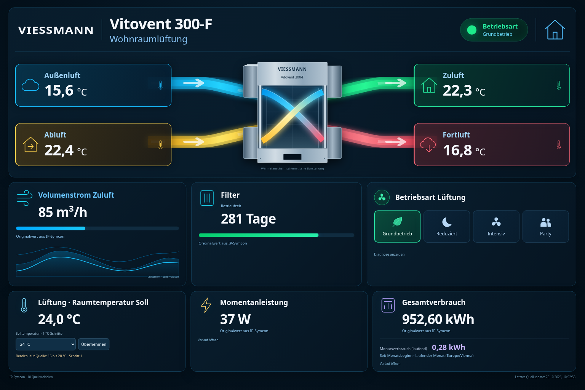

# Viessmann Vitovent 300-F · Kachel für IP-Symcon

Eigenständiges PHP-Modul für die **Kachelvisualisierung ab IP-Symcon 7.1**. Dunkles, responsives Dashboard mit zentralem Wärmetauscher, vier farbigen Luftwegen, vier Temperaturen, Volumenstrom, Filterrestzeit, Momentanleistung, Gesamtverbrauch und profilbasierter Betriebsartensteuerung. Ausschließlich Lüftungsdaten, keine Heizungswerte.



*Screenshot: synthetische Testdaten, auch die vier sichtbaren Betriebsarten sind reine Beispieldaten. Er enthält keine ermittelten Betriebsarten deiner Anlage.*

## Installation

Für eine vorhandene Installation: Repository in **Module Control aktualisieren**, Instanz öffnen und **Übernehmen** drücken, danach die Kachel neu öffnen. Eine neue Instanz ist nicht nötig.

Für die Erstinstallation:

1. In der IP-Symcon-Verwaltungskonsole **Module Control** öffnen, über **Hinzufügen** die URL `https://github.com/somm86/Viessmann-Vitovent-300F-Kachel-Symcon` eintragen und den veröffentlichten Branch auswählen.
2. Instanz **Vitovent 300-F Kachel** anlegen. Die zehn Quellvariablen prüfen, dann **Übernehmen**.
3. Die Instanz in der Kachelvisualisierung hinzufügen bzw. verlinken. Für die Übersicht eine ausreichend große Kachel wählen.

Für eine Installation ohne GitHub: das Release-ZIP entpacken und den darin enthaltenen Bibliotheksordner `Vitovent300F_Kachel` vollständig nach `<Symcon-Datenverzeichnis>/modules/` auf dem **Symcon-Server** kopieren, anschließend den Symcon-Dienst neu starten. Direkt darunter muss `library.json` liegen. Nicht gleichzeitig per Module Control und lokal installieren: beide Pakete haben dieselben GUIDs. Betriebssystemdetails und Prüfschritte: [Installationsanleitung](docs/INSTALLATION.md).

## Neue IDs und steuerbare Solltemperatur ab 1.11

Die sieben Lüftungsquellen wurden nach dem Screenshot vom 26.10.2026 aktualisiert. Bestehende Instanzen mit den bisherigen **Standard-IDs** werden beim Modul-Update über die offizielle `Migrate()`-Funktion einmalig auf die neuen IDs umgestellt. Davon abweichende eigene Zuordnungen bleiben erhalten. Danach werden die alten Zuordnungen nicht bei jedem Start erneut überschrieben. Die Strom-IDs 48602/50335 bleiben unverändert, da sie im neuen Screenshot nicht enthalten sind. In der Instanz bitte die tatsächlichen Zuordnungen kontrollieren.

**LüftungRaumtempSoll (41384)** erhält eine eigene Temperaturkarte mit **Dropdown in 1-°C-Schritten** und **Übernehmen**. Die Steuerung verwendet ausschließlich die vorhandene Quellvariablenaktion über `RequestAction()`; es wird kein Quellwert direkt gesetzt. Min/Max/Schrittweite oder konkrete Auswahlwerte stammen aus dem wirksamen Profil bzw. der modernen Darstellung. Vor jedem Schalten prüft der Server diese erneut. Innerhalb deklarierter Grenzen wird eine Auswahl im 1-°C-Raster erzeugt; von der Quelle ausgeschlossene Werte werden nicht angeboten. Ohne deklarierte Grenzen gibt es nur **aktueller Sollwert −1 °C / aktueller Sollwert / aktueller Sollwert +1 °C**, keinen erfundenen absoluten Temperaturbereich. Nach Bestätigung der neuen Temperatur wandert diese relative Auswahl mit. Ein vorhandener Nachkommaanteil bleibt bei 1-°C-Änderungen erhalten. Die Geräteaktion führt zusätzlich ihre native Validierung aus. Ohne gültige Aktion bleibt die Steuerung gesperrt.

Die angezeigte Solltemperatur ändert sich erst mit dem Quellwert. Fehler erscheinen in der Karte; nach 15 Sekunden ohne passenden Quellwert gibt es einen Hinweis. Im Instanzformular liefert **Solltemperatur-Diagnose anzeigen** die tatsächlich erkannten Grenzen, Auswahlwerte und Aktions-ID. Die im Beispielbild gezeigten 16–28 °C / 0,5 °C sind reine Testprofilwerte und keine eingebauten Geräteannahmen.

Heizungs-Betriebsart, Heizkreispumpe, Heizungs-Raumsolltemperatur und Warmwasserwerte aus dem Screenshot werden nicht übernommen.

## Temperaturverlauf ab Version 1.6

Auf **Außenluft, Zuluft, Abluft oder Fortluft klicken**, um deren Diagramm zu öffnen (auch per Tastatur mit Enter/Leertaste). Zeitbereiche: **24 Stunden, 7 Tage, 30 Tage und 365 Tage**. **Zurück/Weiter** springen jeweils um den ausgewählten Zeitraum; **Jetzt** kehrt zum aktuellen Zeitfenster zurück. Es gibt keine Navigation in die Zukunft. Schließen über ✕ oder Escape.

Voraussetzung: Die jeweilige Temperaturvariable muss in einem bestehenden **Archive Control mit Standardaggregation protokolliert** sein. Das Modul liest die vorhandenen Werte nur und aktiviert oder verändert keine Protokollierung. Bei fehlender Protokollierung, fehlendem Archiv oder einem leeren Zeitraum zeigt das Diagramm einen Hinweis. Vergangene Daten können durch nachträgliches Aktivieren nicht rückwirkend erzeugt werden.

Bis 30 Tage werden **stündliche Mittelwerte**, in der Jahresansicht **tägliche Mittelwerte** angezeigt. Die Achse und die Punktinformationen verwenden die Browser-Zeitzone. Lücken bleiben sichtbar, Werte zwischen vorhandenen Punkten werden geradlinig verbunden. Zusätzlich sind ab 1.8 die beiden konfigurierten Stromwerte im selben Diagrammdialog verfügbar; die Betriebsartensteuerung bleibt davon unabhängig.

## Stromwerte und Diagramme ab Version 1.8

**Momentanleistung** liest die Wirkleistung von Variable **48602**, **Gesamtverbrauch** den Gesamtzählerstand von **50335**. Beide IDs können im Instanzformular geändert werden. Die Liveanzeige übernimmt die Originaleinheit, beispielsweise W und kWh. Verbrauchswerte werden mit genau zwei Nachkommastellen dargestellt; die zugrunde liegenden Werte werden nicht verändert. Keine Umrechnung oder Veränderung der Quellvariablen.

Auf die jeweilige Karte klicken, um den Verlauf mit der vorhandenen Zeitbereichsauswahl und Vor-/Zurück-Navigation zu öffnen. Voraussetzung ist die Protokollierung im Archive Control:

- Momentanleistung: Standardaggregation; Diagramm mit stündlichen bzw. täglichen Mittelwerten in der Quelleneinheit.
- Gesamtverbrauch bei **Zähleraggregation**: Balkendiagramm mit tatsächlichem Verbrauch je Stunde bei 24 Stunden und **je Tag ab 7 Tagen, einschließlich 365 Tagen** aus den Archiv-Zählerdifferenzen. Dies sind Verbrauchsmengen, keine Gesamtzählerstände und keine Leistungswerte.
- Gesamtverbrauch bei **Standardaggregation**: ab 7 Tagen täglicher, sonst stündlicher Linienverlauf der archivierten Gesamtzählerstände (Mittelwerte), ausdrücklich als Zählerstand beschriftet. Aus diesen Mittelwerten wird kein Intervallverbrauch berechnet.

**Monatsverbrauch (laufend)** steht zusätzlich in der Gesamtverbrauchskarte. Er zeigt den echten Verbrauch seit dem ersten Tag des laufenden Kalendermonats um 00:00 Uhr in der Symcon-Serverzeitzone bis zum aktuellen Stand. Dafür muss Variable 50335 im Archive Control als **Zähler** protokolliert werden. Ohne diese Voraussetzung oder ohne Daten des laufenden Monats erscheint „—“ mit Hinweis, kein erfundener Nullwert. Der Monatsverbrauch wird bei Änderungen der Energiequelle oder spätestens nach einer Minute neu gelesen.

Das Modul erkennt die Archivierungsart automatisch und ändert sie nicht. Auch Einheiten im Diagramm stammen aus dem Profil bzw. der Darstellung. Wenn keine Einheit hinterlegt ist, wird „Quelleneinheit“ gemeldet. Gesamtverbrauch, Monatsverbrauch sowie Werte und Tooltips im Verbrauchsdiagramm haben genau **zwei Nachkommastellen**. Die Angaben im Screenshot sind Beispieldaten; auf der Anlage werden die tatsächlichen Werte geladen.

## Kachelgröße

Das Dashboard nutzt die vollständige Kachelbreite und passt gleichzeitig in die verfügbare Höhe. Vor einer nötigen Verkleinerung wird die interne Layoutbreite entsprechend erweitert; dadurch entstehen keine breiten seitlichen Leerflächen. Inhalte werden neu umgebrochen, Symbole bleiben unverzerrt. Ein `ResizeObserver` erfasst Änderungen der Kachel und des Inhalts. Auch nach Datenupdates und beim Öffnen der Diagnose wird das Layout neu eingepasst.

## Vorbelegte Quellvariablen

| Anzeige | ID | Eigenschaft |
|---|---:|---|
| Außenluft | 31044 | `OutsideID` |
| Zuluft | 42234 | `SupplyID` |
| Abluft | 58476 | `ExtractID` |
| Fortluft | 22909 | `ExhaustID` |
| Volumenstrom | 34190 | `FlowID` |
| Filterrestzeit | 38673 | `FilterID` |
| Betriebsart | 28301 | `ModeID` |
| Momentanleistung | 48602 | `PowerID` |
| Gesamtverbrauch | 50335 | `EnergyID` |
| Lüftung Raumtemperatur Soll | 41384 | `SetpointID` |

Die Variablen müssen bereits von deiner Geräteintegration aktualisiert werden. Das Modul spricht das Gerät nicht selbst an und benötigt keine Viessmann-Zugangsdaten. Es legt keine Messvariablen an und verändert keine Quellprofile. Temperaturwerte müssen in °C vorliegen. Volumenstrom und Filterrestzeit werden mit `GetValueFormatted()` gemäß dem tatsächlichen Quellprofil angezeigt; ohne Einheit im Profil wird keine erfunden. Balken werden nur angezeigt, wenn das echte Quellprofil bzw. die Darstellung einen gültigen Min-/Max-Bereich liefert. Filtertage und Maximalvolumenströme werden nicht angenommen. Die Wellen sind ausdrücklich schematische Dekoration, keine Messhistorie.

## Betriebsart: ausschließlich vorhandene Werte

Die Kachel liest die wirksame Auswahl von Variable 28301:

- Klassische Profile: benutzerdefiniertes Profil vor Standardprofil, ausschließlich vorhandene Assoziationen.
- Moderne Darstellung **Aufzählung**: ausschließlich die über `IPS_GetVariablePresentation()` gelieferten `OPTIONS` mit ihren tatsächlichen `Value`-/`Caption`-Feldern (API verfügbar ab Symcon 8.1). Eine wirksame moderne Darstellung hat Vorrang vor veralteten Profilfeldern.

Die gefundenen Werte erscheinen als anklickbare Betriebsart-Kacheln. Icons werden nach den tatsächlichen Beschriftungen gewählt; Werte werden dadurch nicht verändert. Es gibt **keine fest hinterlegte Liste** von Betriebsarten. Zusätzlich muss die wirksame Variablenaktion auf eine vorhandene Instanz oder ein vorhandenes Skript zeigen. Eine benutzerdefinierte Aktion `1` sperrt die Steuerung ausdrücklich; sie wird nicht durch die Standardaktion ersetzt.

Jede Anforderung wird serverseitig erneut gegen das **aktuelle** Profil bzw. die wirksame Aufzählung geprüft und mit erhaltenem Integer-/Float-/Boolean-/Stringtyp über `RequestAction(QuellvariablenID, Wert)` weitergegeben. Ein frei eingesandter, veralteter oder nur ungefähr gleicher Wert wird abgewiesen. Die Kachel ändert die angezeigte Betriebsart erst nach dem Quellwert-Update. Fehler der serverseitigen Aktion werden über den SDK-Nachrichtenkanal sichtbar gemacht, da `requestAction()` laut offizieller Dokumentation keinen Rückgabewert hat. Nach 15 Sekunden ohne passenden Quellwert erscheint ein Hinweis; eine erfolgreiche Geräteumschaltung wird dann nicht behauptet.

**Die tatsächlichen Profile, Darstellungsoptionen und Aktionswerte deiner Installation waren hier nicht verfügbar.** Bei „keine passenden Profil-Assoziationen“ mit einer modernen Aufzählung ist die zusätzliche Auswertung ab Version 1.2 vorgesehen. Falls weiterhin keine Auswahl erscheint: in der Kachel **Diagnose anzeigen** öffnen oder in der Instanz **Betriebsart-Diagnose anzeigen** verwenden; dort stehen die tatsächlich erkannten Werte, die Auswahlquelle und die Aktions-ID. Zur Prüfung das nur lesende Skript [docs/inspect-symcon.php](docs/inspect-symcon.php) im IP-Symcon-Skripteditor ausführen. Es führt keine Schaltaktion aus. Profil-Assoziationen belegen allein noch nicht, dass das dahinterliegende Gerät jeden Wert akzeptiert: den Test an der Anlage gemäß Installationsanleitung durchführen.

## Entwicklung und Prüfung

Laufzeit: keine Composer-, npm-, CDN- oder WebHook-Abhängigkeiten. PHP, HTML, CSS und JavaScript liegen im Modul. Die Symcon-Kachel stellt den HTML-SDK-Bridge bereit.

```sh
python3 tests/manifests_test.py
# Offizielle SymconStubs separat klonen, außerhalb des Repositorys:
git clone https://github.com/symcon/SymconStubs.git /tmp/SymconStubs
git -C /tmp/SymconStubs checkout 31f2e0478eb3763236fcf44ea4144271fdeddfd5
php -l Vitovent300FTile/module.php
SYMCON_STUBS=/tmp/SymconStubs php tests/module_test.php
# Optionaler Browser-Test (benötigt Python + Playwright + Chromium):
python3 -m pip install playwright==1.62.0
python3 -m playwright install chromium
python3 tests/browser_test.py
# Bei vorhandenem System-Chromium alternativ:
# CHROMIUM_PATH=/usr/bin/chromium python3 tests/browser_test.py
python3 tests/build.py
python3 tests/package_test.py
```

Der Build erzeugt `docs/downloads/Vitovent300F-Kachel-1.12.zip`, das separate Quellpaket `docs/downloads/Vitovent300F-GitHub-1.12.zip` und jeweils eine SHA-256-Datei. Das ZIP enthält einen Bibliotheksordner mit `library.json`, Modul und Dokumentation. Tests, Git-Daten und Testprofile sind nicht im Laufzeitmodul. Der GitHub-Workflow prüft PHP, Manifeste und Browser und stellt das ZIP als Build-Artefakt bereit. Der Workflow wurde lokal vorbereitet, jedoch noch nicht auf GitHub ausgeführt.

[Prüfbericht und Grenzen](docs/VALIDATION.md) · [API-Verwendung und Quellen](docs/API.md) · [Änderungen](CHANGELOG.md)

Ausgangspunkt ist das vom Nutzer bereitgestellte `Vitovent300F_Kachel_Modul.zip`. Bibliotheks- und Modul-GUID sowie Klassenname und Präfix bleiben für Updates erhalten. Keine Verbindung zu oder Freigabe durch Viessmann oder Symcon. Im Ausgangsarchiv lag keine Lizenzdatei; vor einer öffentlichen Weiterverteilung bitte die Rechte am Ausgangscode klären. Es wurde keine Lizenz stellvertretend erteilt.
